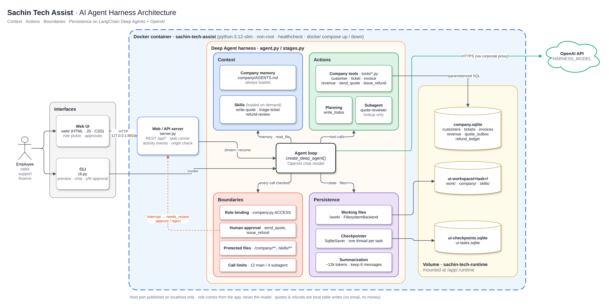
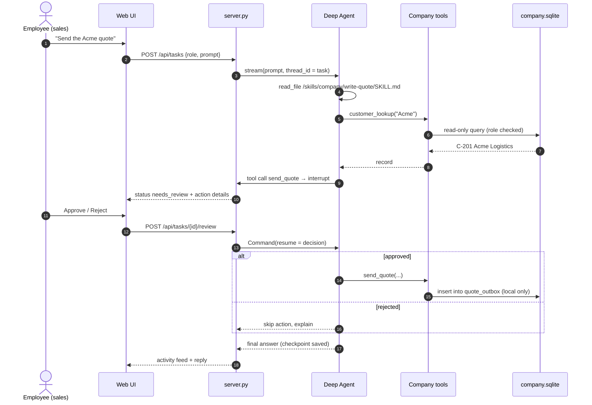

# AI Agent Harness POC: Sachin Tech Assist

A small, runnable **agent harness** for a fictional company.

**Sachin Tech** sells *SachinFleet*, an IoT fleet-monitoring platform. Employees in **sales**, **support** and
**finance** use the internal assistant, *Sachin Tech Assist*. All company data is dummy data in a local SQLite file.

A harness is everything around the model that makes it useful and safe at work. This POC builds it in four pillars:

| Pillar | What it answers | Files |
|---|---|---|
| **Context** | What should the agent know? | `company/AGENTS.md` (always loaded), `skills/**/SKILL.md` (loaded on demand) |
| **Actions** | What can it do? | `tools/`, `company.py`, `agent.py` (planning + `quote-reviewer` subagent) |
| **Boundaries** | Who may do what, and what needs a human? | `company.py` (`ACCESS`), `tools/binding.py`, `agent.py` (protected files, approvals, call limits) |
| **Persistence** | What survives a reply or a restart? | `workspace.py` (`/work/` files), SQLite checkpoints, context summarization in `agent.py` |

## Architecture



The source is [docs/architecture.drawio](docs/architecture.drawio). Open it in [draw.io](https://app.diagrams.net) or with the VS Code
*Draw.io Integration* extension. The PNG also has the diagram embedded, so you can open the PNG in draw.io and edit it directly.

### Request flow with human approval



Each tool call in the UI's activity feed is a real event from the agent run. Events are color-coded by pillar: blue for Context, green for Actions, coral for Boundaries, and purple for Persistence.

## Project layout

```
ai-agent-harness-poc/
├── agent.py          # Full harness configuration (all four pillars)
├── stages.py         # Same harness at each stage: base → context → actions → boundaries → persistence
├── company.py        # Dummy company DB + role access rules (application-owned)
├── tools/            # Company tools (@tool functions) + role binding
├── company/AGENTS.md # Company conventions, pricing and policy (always-loaded memory)
├── skills/           # write-quote, triage-ticket, refund-review procedures
├── workspace.py      # Per-task working folders and read-only reference backend
├── runtime.py        # OpenAI model factory, preview model, console output
├── cli.py            # Command-line runner (preview, one-shot, interactive, approvals)
├── server.py         # Local web chat server
├── web/              # Chat UI (index.html, app.js, style.css)
├── docs/             # Architecture diagram (draw.io source + PNG)
├── Dockerfile        # Container image (python:3.12-slim, non-root)
└── docker-compose.yml# One-command up/down with a persistent volume
```

## Setup

Requires Python 3.12.

```sh
cd ai-agent-harness-poc
python3.12 -m venv .venv
.venv/bin/pip install -r requirements.txt
cp .env.example .env      # then set OPENAI_API_KEY (and optionally HARNESS_MODEL)
```

`HARNESS_MODEL` defaults to `openai:gpt-5.4`. Any OpenAI chat model works, for example `openai:gpt-4.1-mini`.
Set `OPENAI_BASE_URL` to use an OpenAI-compatible gateway. Keep keys in `.env`, which Git ignores.

## Run from the command line

```sh
# Compile every stage for every role. No API key needed, no model calls.
.venv/bin/python cli.py --preview

# Interactive chat with the full harness as a sales employee.
.venv/bin/python cli.py --role sales

# One-shot requests.
.venv/bin/python cli.py --role finance -p "Compare revenue for 2026-Q2 and 2026-Q3. Cite the records."
.venv/bin/python cli.py --role support -p "Use our triage skill to investigate Beacon Foods' delayed alerts."

# Try an earlier stage to see what each pillar adds.
.venv/bin/python cli.py --stage actions --role support -p "What was revenue in 2026-Q3?"

# Resume a saved conversation (persistence stage). The thread ID is printed at exit.
.venv/bin/python cli.py --role sales --thread sales-1a2b3c4d
```

When the agent calls `send_quote` or `issue_refund`, the CLI pauses and asks `Approve …? [y/N]`.

## Run with Docker (one command up, one command down)

```sh
cp .env.example .env              # set OPENAI_API_KEY (optional: without it the UI loads but tasks error)
docker compose up -d --build      # build + start → http://127.0.0.1:8502
docker compose down               # stop (tasks, checkpoints and dummy DB are kept in a volume)
docker compose down -v            # stop and wipe all saved state
```

- `docker compose logs -f` follows the server log. `docker compose ps` shows health status.
- Run the CLI inside the container: `docker compose exec sachin-tech-assist python cli.py --role finance -p "Revenue for 2026-Q3?"`
- The port is published on host **localhost only** (`127.0.0.1:${HARNESS_PORT:-8502}`). Change it with `HARNESS_PORT` in `.env`.
- Behind a corporate proxy, Docker passes the proxy settings from `~/.docker/config.json` (`proxies`) into the build and the container, so pip and OpenAI calls go through it.
- State lives in the named volume `sachin-tech-runtime`, mounted at `/app/.runtime`. The container runs as a non-root user.

## Run the web UI

```sh
.venv/bin/python server.py
```

Open http://127.0.0.1:8502. If you work on a remote machine, forward port 8502 (VS Code does this from the **Ports** view).
Use `HARNESS_PORT=8503` for another port, or `HARNESS_STAGE=boundaries` to run an earlier stage.
The server binds to localhost only.

The UI includes a role selector with that role's tools, starter prompts, task history, and an inline activity feed of real
tool events, color-coded by pillar: blue Context, green Actions, coral Boundaries, purple Persistence. It also has
approve/reject controls, the agent's plan, saved `/work/` files, and a list of approved local actions.

### Things to try

| Role | Prompt | Shows |
|---|---|---|
| Sales | "Use our quote skill to prepare a quote for Acme Logistics from the customer record. Save it to /work/quote.md. Do not send it." | Skill + tool + saved file |
| Sales | "Ask the quote reviewer to check: 'We will onboard all 300 Beacon trailers in 1 week at $5 per device.'" | Subagent delegation |
| Sales | "Send the Acme Logistics quote you prepared." | Human approval |
| Support | "Use our triage skill to investigate Beacon Foods' delayed temperature alerts." | Skill + ticket records |
| Support | "What was revenue in 2026-Q3?" | Role boundary (tool not available) |
| Finance | "Beacon Foods asks for a $500 credit on INV-5002 because of T-1001. Review it and issue the refund if allowed." | Policy skill + approval |

## Stages

`stages.py` builds the harness one pillar at a time:

| Stage | Adds |
|---|---|
| `base` | Model + agent loop only |
| `context` | `AGENTS.md` memory + skills, read-only |
| `actions` | All company tools, `write_todos` planning, `quote-reviewer` subagent. Tool-level role checks still deny calls. |
| `boundaries` | Role-filtered tool list, write-protected `/company/` and `/skills/`, approval for `send_quote`/`issue_refund`, model-call limits |
| `persistence` | Writable `/work/`, SQLite checkpoints, summarization at about 12k tokens (keeps 6 recent messages) |

See [TOOLS.md](TOOLS.md) for the tool catalog.

## Scope and safety notes

- All data is synthetic. `send_quote` writes to a local `quote_outbox` table, and `issue_refund` writes to a local `refund_ledger`. No email is sent and no money moves.
- The role selector demonstrates application-owned access rules. A real deployment needs authenticated identity and server-side role mapping.
- Runtime state lives in `.runtime/`: the company DB, checkpoints, and per-task workspaces. Delete the folder to reset.
- The local filesystem backend is not a sandbox. Production use needs auth, isolation and evaluations.

## Extend it

1. **New tool:** add an `@tool` function in `tools/`, register it in `tools/__init__.py`, and grant it to roles in `company.py` `ACCESS`. If it has external effects, add it to `APPROVAL_REQUIRED` in `agent.py`.
2. **New skill:** add `skills/<team>/<name>/SKILL.md` with `name`/`description` front matter.
3. **New role:** add an entry to `ACCESS` and, optionally, UI starters in `server.py` `STARTERS`.
